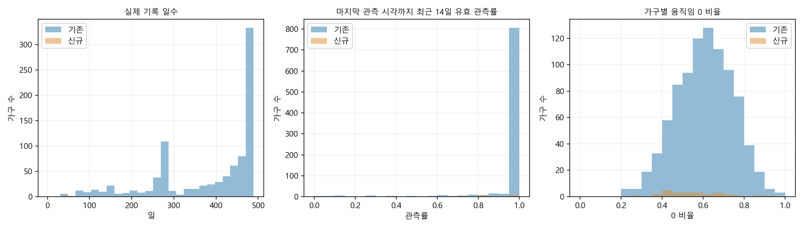
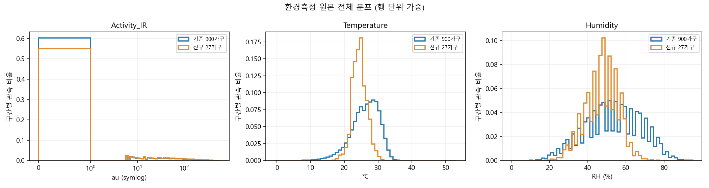
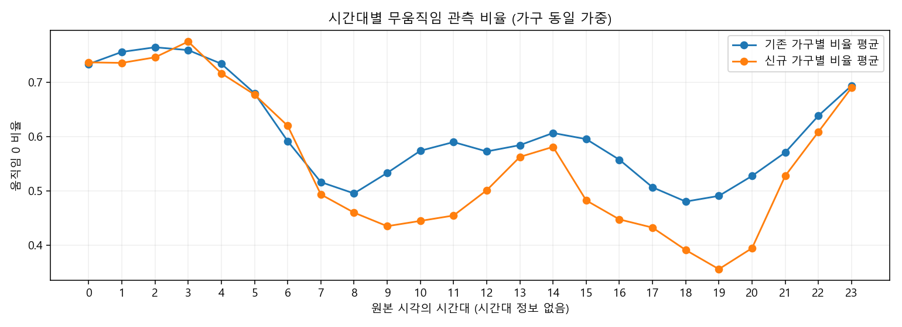
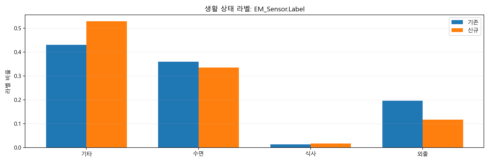

# 독거노인 돌봄용 위험감지 데이터 EDA — 온살핌 활용 검토

분석일: 2026-10-13. 대상: 사용자가 제공한 `Dataset` 디렉터리의 모든 ZIP 47개. 온라인 자료나 외부 서비스에 데이터·개인정보를 전송하지 않았다. 원본을 수정하지 않았으며 모델 학습, 서비스 코드 구현, 알림 임계값 자동 확정은 수행하지 않았다.

> 2026-10-16: 이 파일은 연구 기록이다. 서비스 판정·화면·시연 프로필은 여기의 14일 개인 기준을 쓰지 않는다. 시연 세대의 아침 기준은 `IOT/data/care_profiles.json`의 09:00이다.

## 핵심 결과와 분석 범위

- **실제 확보된 데이터는 기존 900가구 + 신규 27가구 = 927가구**다. 요청에 언급된 1,000 + 30 전체 모집단의 90%다. Training 800+24, Validation 100+3만 있고 Test 디렉터리는 없다. 미확보 100+3가구는 분석하지 않았으며, 전체 1,030가구로 결과를 외삽하지 않는다. 누락된 신규 원본 ID 범위는 보고서에 직접 노출하지 않는다.
- 환경측정 CSV **49,058,881행**, 라벨 JSON **49,058,881레코드**를 전체 순회했다. 센서 분포의 분모는 원본 환경측정 행이며 JSON에 복제된 센서값은 이중 합산하지 않았다.
- ZIP 합계 **2.241 GB (2.087 GiB)**, ZIP 내부 논리 크기 **38.938 GB (36.264 GiB)**. 압축 파일 크기만을 기준으로 메모리 요구량을 판단하면 안 된다.
- 마지막 관측까지 최근 14일이 완전한 가구는 **648가구**. 과거 어느 구간이라도 일별 유효 관측률 90% 이상의 연속 14일을 확보한 가구는 **905가구**. 정의별 수는 아래에서 구분한다.
- `Activity_IR`는 다값 수치이고 단위가 `au`다. 0/1 PIR ON/OFF와 **직접 호환되지 않는다**. PIR 기반 원신호를 어떻게 집계한 값인지는 이 데이터만으로 **불확실**하다. `Activity_IR > 0`을 움직임 존재의 연구용 대리 지표로 검토할 수 있지만 PIR ON 상태, 재실, 안전 확인으로 동치 해석할 수 없다.
- 가구별 14일 기준선 연구에 사용할 수 있으나, 결측·센서 단위·생활 상태 라벨의 생성 근거를 확인한 후 적용해야 한다. 실제 위험 사건의 정답과 알림 효과는 이 EDA로 검증되지 않는다.

## 1. 디렉터리, 파일 종류, 크기, 가구 수

```text
Dataset/
└─ 68.독거노인 돌봄용 위험감지 데이터/
   └─ 3.개방데이터/1.데이터/
      ├─ Training/
      │  ├─ 01.원천데이터/ TS_A.* (신규), TS_B.* (기존)
      │  └─ 02.라벨링데이터/ TL_A.*, TL_B.*
      └─ Validation/
         ├─ 01.원천데이터/ VS_A.*, VS_B.*
         └─ 02.라벨링데이터/ VL_A.*, VL_B.*
```

가구 수는 파일명 집단 키(A/B+번호)의 합집합을 내부에서 세고, 환경측정 및 라벨 파일 존재를 대조했다. CSV의 숫자 ID는 A/B가 중복될 수 있고 선행 0도 달라지므로 단독 결합 키로 쓰지 않는다. 결과 식별자 `E001…`은 기존, `N001…`은 신규이며 각 집단 원본 키 정렬 순번으로 만든 로컬 가명이다. 재식별 가능성이 있는 가구별 생활 시각·통계 파일은 로컬에 보관해야 한다.

내부 파일 총 113,608개: .csv 2,862개, .json 927개, .png 109,819개. 환경·생체·응급·상담·메타데이터는 CSV, 라벨은 JSON, 적외선 이미지은 PNG다. 이미지 전체는 ZIP 중앙목록의 개수·크기를 조사했으며 영상 내용의 인식, 이미지 디코딩 품질 검사는 수행하지 않았다. 상담 자유서술과 개인 메타 필드는 분석 산출물에 복사하지 않았다.

압축 묶음별 크기(바이트, 내부 members는 파일 수):

| group | bytes | expanded_bytes | members |
| --- | --- | --- | --- |
| TL_A | 5093675 | 194607358 | 24 |
| TL_B | 858607216 | 28133016009 | 800 |
| TS_A | 684466628 | 713797633 | 100747 |
| TS_B | 462066301 | 5441151772 | 2400 |
| VL_A | 493657 | 17886390 | 3 |
| VL_B | 109712420 | 3665220275 | 100 |
| VS_A | 61386662 | 64120050 | 9234 |
| VS_B | 59244310 | 707965641 | 300 |

| 집단 | 가구 | 원본행 | 시작 | 종료 | 기록일수_중앙값 | 기록일수_최소 | 기록일수_최대 |
| --- | --- | --- | --- | --- | --- | --- | --- |
| 기존 | 900 | 48949062 | 2023-05-01 00:10:00 | 2024-08-31 23:50:00 | 442 | 30 | 489 |
| 신규 | 27 | 109819 | 2024-10-04 14:30:00 | 2024-11-24 23:50:00 | 36 | 2 | 47 |

전체 압축파일 상세: [archive_inventory.csv](archive_inventory.csv). 이미지 압축파일의 가구 원본 ID는 `[household]`로 치환했다. 실제 원본을 모두 확보했는지는 AIHub 배포 목록과 추가 대조가 필요하다. 현 디렉터리에 없는 Test 분할의 존재·가구 구성은 직접 검증하지 않았다.

## 2. 가구별 기간·실제 기록 일수·결측

모든 가구의 시작·종료, 관측 날짜 수, 빈 날짜 수, 중복/역순, 간격, 14일 적합성은 [household_coverage.csv](household_coverage.csv)에 있다. 관측 날짜 수는 행이 하나라도 있는 날짜 수로, 24시간 완전 관측과 다르다. 일별 144개 10분 슬롯의 관측률은 [daily_coverage.csv](daily_coverage.csv), 관측 사이 간격이 10분 초과인 전체 구간은 [missing_intervals.csv](missing_intervals.csv)에 있다. 시작 이전·종료 이후는 수집 계약기간을 알 수 없어 결측으로 계산하지 않았다.

| 집단 | 타임스탬프결측 | 중복시각 | 값충돌시각 | 역순 | 격자외 | 완전누락일 | 라벨중복시각 | 라벨원본시각불일치 | 라벨원본값불일치 | 원본중라벨누락 |
| --- | --- | --- | --- | --- | --- | --- | --- | --- | --- | --- |
| 기존 | 0 | 0 | 0 | 31 | 0 | 17307 | 0 | 0 | 0 | 0 |
| 신규 | 0 | 0 | 0 | 0 | 0 | 120 | 0 | 0 | 0 | 0 |

최대 공백이 큰 10가구:

| household | cohort | start | end | recorded_days | missing_whole_days | gap_count | max_gap_minutes | latest14_coverage |
| --- | --- | --- | --- | --- | --- | --- | --- | --- |
| E017 | B | 2023-05-01 00:10:00 | 2024-08-31 23:50:00 | 67 | 422 | 9 | 594,060 | 0.999 |
| E023 | B | 2023-05-01 00:10:00 | 2024-08-31 23:50:00 | 79 | 410 | 6 | 592,710 | 1 |
| E041 | B | 2023-05-01 00:10:00 | 2024-08-31 23:50:00 | 129 | 360 | 3 | 519,680 | 1 |
| E288 | B | 2023-05-01 00:10:00 | 2024-08-31 23:50:00 | 134 | 355 | 14 | 513,250 | 1 |
| E008 | B | 2023-05-01 00:10:00 | 2024-08-31 23:50:00 | 153 | 336 | 56 | 485,820 | 0.997 |
| E050 | B | 2023-05-01 00:10:00 | 2024-08-31 23:50:00 | 180 | 309 | 1 | 446,660 | 1 |
| E820 | B | 2023-05-01 00:10:00 | 2024-08-31 23:50:00 | 159 | 330 | 7 | 437,870 | 0.7584 |
| E013 | B | 2023-05-01 00:10:00 | 2024-08-31 23:50:00 | 190 | 299 | 3 | 432,630 | 1 |
| E319 | B | 2023-05-11 14:00:00 | 2024-08-31 23:50:00 | 160 | 319 | 50 | 412,810 | 1 |
| E056 | B | 2023-05-01 00:10:00 | 2024-08-31 23:50:00 | 206 | 283 | 2 | 408,570 | 1 |

`missing_10min_slots = ceil(관측간격/10분)-1`. 이는 관측 사이 누락 슬롯의 추정치이며, 격자 외 시각은 별도 품질 플래그로 남긴다. 완전누락일은 각 가구 최초~최종 날짜 안에서 0행인 날짜의 합계다. 중복시각은 최초 행 외 행 수, 값충돌시각은 같은 시각에서 센서값이 다른 시각 수다. 원본행 분포에는 중복이 포함되고, 시간 커버리지는 시각 중복을 제거해 계산했다.



## 3. 연속 14일 가능 가구 수

| 집단 | 가구 | 연속14일_기록존재 | 연속14일_일별90퍼센트 | 연속14일_완전한달력일 | 연속2016개_유효관측 | 최근14일_완전 |
| --- | --- | --- | --- | --- | --- | --- |
| 기존 | 900 | 899 | 894 | 889 | 890 | 648 |
| 신규 | 27 | 21 | 11 | 3 | 3 | 0 |
| 전체 | 927 | 920 | 905 | 892 | 893 | 648 |

- **기록 존재**: 하루에 1행 이상 있는 달력 날짜가 14일 이어짐. 데이터 존재의 최소 확인이며 패턴 분석 품질을 보장하지 않는다.
- **일별 90%**: 각 날짜에 유효한 10분 정각 관측 130개 이상(130/144=90.28%)이 있는 날짜가 14일 이어짐. 90%는 활용 가능성 검토용 임시 품질 기준이며 실제 알림 임계값이 아니다.
- **완전한 달력일**: 각 날짜에 유효한 정각 슬롯 144개가 있는 날짜 14일 연속.
- **연속 2016개**: 정확히 10분 간격의 유효 관측 2016개 이상 연속. 각 관측을 10분 슬롯으로 보면 14일이며 최초~최종 타임스탬프 차이는 13일 23시간 50분이다. 달력일 기준과 다르다.
- **최근14일**: 각 가구 최종 관측 `t` 기준 `(t-14일, t]`에 유효한 정각 관측 2016개가 모두 존재. 2026년 현재 시점의 최근 14일 데이터라는 뜻이 아니다. `latest14_coverage`의 분모는 항상 2016이다.
- 유효 관측: 세 필드가 수치·유한값이며 Activity_IR≥0, Humidity 0~100, Temperature -40~85°C 범위, 10분 격자. 온도 범위는 넓은 **EDA 검토용 가정**으로 기기 정격을 확인한 규격이 아니다. 고위험 온도 기준으로 사용하지 않는다. 무한값·음수·물리 범위 이탈은 제외하되 통계적 IQR 이상값은 제거하지 않았다.

## 4. Activity_IR 범위·분포·주기·0 비율

전체 센서 통계(결측률 분모는 집단별 원본행, 표의 zero_rate 분모는 유한 수치값):

| cohort | field | n | minimum | p01 | p25 | p50 | p75 | p99 | maximum | mean | std | zero_rate | missing_or_non_numeric | infinite | plausibility_flagged | iqr_outliers |
| --- | --- | --- | --- | --- | --- | --- | --- | --- | --- | --- | --- | --- | --- | --- | --- | --- |
| A | Activity_IR | 109819 | 0 | 0 | 0 | 0 | 24 | 300 | 560 | 26.5 | 58.0167 | 0.5505 | 0 | 0 | 0 | 14323 |
| A | Temperature | 109819 | 12.8 | 19 | 23 | 24.5 | 25.9 | 29.7 | 32.7 | 24.5024 | 2.1046 | 0 | 0 | 0 | 0 | 1331 |
| A | Humidity | 109819 | 16 | 27 | 42 | 48 | 53 | 66 | 78 | 47.4271 | 8.5402 | 0 | 0 | 0 | 0 | 950 |
| B | Activity_IR | 48949062 | 0 | 0 | 0 | 0 | 17 | 237 | 587 | 19.6128 | 46.7915 | 0.603 | 0 | 0 | 0 | 6680569 |
| B | Temperature | 48949062 | -0.6 | 13.5 | 23.7 | 26.6 | 29.2 | 33.3 | 53.2 | 26.0801 | 4.1714 | 0 | 0 | 0 | 0 | 927540 |
| B | Humidity | 48949062 | 0 | 20 | 43 | 53 | 64 | 83 | 95 | 53.256 | 14.6926 | 0 | 0 | 0 | 0 | 18320 |

분위수는 전체 유한값 빈도표를 이용한 정확한 선형 보간 분위수다. 표준편차는 모집단형(ddof=0). 분포는 가구/기간 동일 가중이 아닌 **행 단위 가중**으로 긴 기록 가구의 영향이 크다. 집단별 전수 값 빈도: [sensor_value_counts.csv](sensor_value_counts.csv). `noninteger_count` 등 추가 지표는 [sensor_statistics.csv](sensor_statistics.csv).

| 집단 | 최빈간격_초 | 최빈비율 | 양의간격수 | 10분초과 | 10분미만 | 최대간격_분 |
| --- | --- | --- | --- | --- | --- | --- |
| 기존 | 600 | 0.9989 | 48948162 | 56193 | 0 | 594,060 |
| 신규 | 600 | 0.9952 | 109792 | 523 | 0 | 15,430 |

간격 통계는 가구별 정렬·중복 제거 후 계산했다. 모드 간격은 기록 주기이고 PIR 센서 내부 샘플링 주기가 아니다. 전체 간격 빈도는 [measurement_intervals.csv](measurement_intervals.csv).



0은 수치적으로 유효한 관측이다. 다만 실제 무움직임, 외출·수면, 센서 방향·고장, 데이터 생성 규칙 등을 구별할 근거가 부족하다. 누락을 0으로 채우면 무활동 시간이 과대 추정된다. 다음 그래프는 가구별 시간대 0 비율의 평균이며 연구용 대리 지표다. 시각에 timezone 정보가 없으므로 KST로 확정하지 않았다.



움직임은 기존 **0~587**, 신규 **0~560**의 정수값이며 두 집단 모두 중앙값은 0이다. 원본행 0 비율은 기존 **60.30%**, 신규 **55.05%**다. 10분 간격 비율은 기존 약 **99.89%**, 신규 약 **99.52%**이며, 그 외 간격은 모두 10분의 배수이고 10분 미만은 없다. 이 결과는 집계형 움직임 지표라는 해석에 부합하지만 집계 방식 자체를 증명하지 않는다.

## 5. Temperature·Humidity 결측·이상값

세 센서의 셀 결측·수치변환 실패·무한값은 **0건**이다. 그러나 관측 행 자체의 누락은 존재한다. 기존 온도 **-0.6~53.2°C**, 습도 **0~95%**, 신규 온도 **12.8~32.7°C**, 습도 **16~78%**다. 기존의 0°C **11행**, 습도0 **251행**, 온도 53.2°C 등의 극단값은 원천 단위·장비·해당 구간을 별도 확인할 후보다. 넓은 물리 범위 안에 들어와도 정상 측정이라고 확정할 수 없다.

위 전수 통계의 minimum/maximum, p01~p99, missing_or_non_numeric, infinite를 함께 확인한다. 물리 범위 검토 플래그는 습도 <0 또는 >100, 온도 <-40 또는 >85, 움직임 <0이다. 장비 정격·센서 오차는 이 분석에 제공되지 않았다.

IQR 검토 구간과 이탈 수:

| cohort | field | iqr_low | iqr_high | iqr_outliers | plausibility_flagged | missing_or_non_numeric | infinite |
| --- | --- | --- | --- | --- | --- | --- | --- |
| A | Activity_IR | -36 | 60 | 14323 | 0 | 0 | 0 |
| A | Temperature | 18.65 | 30.25 | 1331 | 0 | 0 | 0 |
| A | Humidity | 25.5 | 69.5 | 950 | 0 | 0 | 0 |
| B | Activity_IR | -25.5 | 42.5 | 6680569 | 0 | 0 | 0 |
| B | Temperature | 15.45 | 37.45 | 927540 | 0 | 0 | 0 |
| B | Humidity | 11.5 | 95.5 | 18320 | 0 | 0 | 0 |

IQR 이탈은 전 집단 분포의 꼬리라는 뜻이며 센서 오류·돌봄 위험의 확정값이 아니다. 가구·계절별 온습도 분포가 달라 전역 경계로 일괄 삭제하지 않는다. 0°C 또는 습도 0도 결측으로 자동 치환하지 않는다. 센서 동시 0/고정값, 급격한 변화, 다른 필드와의 일관성 검토를 후속 전처리에 넣는다. 이번 EDA는 셀 결측과 관측 행 누락을 분리했다. 개별 센서의 전체 연속 결측 에피소드와 장시간 고정값 에피소드 검사는 후속 계획이며, gap CSV는 세 센서 공통의 행 누락 구간이다.

## 6. 생활 상태 라벨

| cohort | component | field | label | count | share |
| --- | --- | --- | --- | --- | --- |
| A | EM_Sensor | Label | 기타 | 58171 | 0.5297 |
| A | EM_Sensor | Label | 수면 | 36876 | 0.3358 |
| A | EM_Sensor | Label | 식사 | 1933 | 0.0176 |
| A | EM_Sensor | Label | 외출 | 12839 | 0.1169 |
| A | ER_Sensor | Label | 위험 | 374 | 0.0034 |
| A | ER_Sensor | Label | 일상 | 109445 | 0.9966 |
| A | SM_Sensor | Label | 위험 | 22 | 0.0002 |
| A | SM_Sensor | Label | 일상 | 109112 | 0.9936 |
| A | SM_Sensor | Label | 주의 | 685 | 0.0062 |
| A | Total_Labeling | Estimation | 기타 | 55913 | 0.5091 |
| A | Total_Labeling | Estimation | 수면 | 17607 | 0.1603 |
| A | Total_Labeling | Estimation | 식사 | 1770 | 0.0161 |
| A | Total_Labeling | Estimation | 외출 | 10491 | 0.0955 |
| A | Total_Labeling | Estimation | 위험 | 3782 | 0.0344 |
| A | Total_Labeling | Estimation | 주의 | 20256 | 0.1844 |
| B | EM_Sensor | Label | 기타 | 21087197 | 0.4308 |
| B | EM_Sensor | Label | 수면 | 17610491 | 0.3598 |
| B | EM_Sensor | Label | 식사 | 644654 | 0.0132 |
| B | EM_Sensor | Label | 외출 | 9606720 | 0.1963 |

각 component의 비율 분모는 해당 component가 존재하는 레코드 수다. component 자체가 없는 레코드는 '__MISSING__'에 포함되지 않는다. component별 존재 수는 [label_quality.csv](label_quality.csv)의 components JSON으로 별도 확인한다. 모든 가구별 종류·개수·비율은 [household_labels.csv](household_labels.csv), 집단 합계는 [label_distribution.csv](label_distribution.csv).



환경 생활 상태는 두 집단 모두 **기타·수면·식사·외출** 4종이다. 기존 환경 라벨에는 위험·주의가 없다. 신규의 종합 라벨에는 위험 **3,782행**, 주의 **20,256행**이 있지만 이는 독립 사고 횟수가 아니라 10분 레코드의 라벨 수다. 원천과 JSON의 환경 시각·세 센서값은 전체 **49,058,881행**에서 일치했고 누락·중복 시각은 없었다.

EM_Sensor.Label과 신규의 SM_Sensor.Label·ER_Sensor.Label·Total_Labeling.Estimation을 분리했다. 이들을 한 개의 동일 정답으로 합치지 않는다. 라벨 JSON의 환경 센서 시각을 CSV와 결합해 값 일치도도 전수 점검했다(2절). JSON 레코드에는 상담 등 다른 모달리티가 결합돼 있으며 파일 순서를 시간 순서로 가정하지 않는다. 라벨 생성 지침·검수 방식·실제 위험 사건과의 대응은 로컬 파일에서 확인되지 않아 라벨을 의료적 위험 또는 이상 없음의 보증으로 해석하지 않는다. Reason, Memo, Counseling, Information, Caption 자유서술은 통계 결과에 노출하지 않았다.

## 7. 기존 1,000가구와 신규 30가구 구조 차이

아래 비교는 확보분 기존 900·신규 27 기준이다.

| 항목 | 기존 B | 신규 A |
| --- | --- | --- |
| 환경 CSV | ID, Time, Temperature, Humidity, Illuminance, Activity_IR, CO2, TVOC | 같은 열 |
| 추가 원천 | 상담, 메타데이터 | 생체신호, 적외선 이미지 PNG, 응급요청, 상담, 메타데이터 |
| JSON | TimeSeriesData, EM_Sensor, Counseling 중심 | 추가 SM_Sensor, IR_Sensor, ER_Sensor, Total_Labeling |
| 환경 장비 | 메타데이터 ModelList: SME20SD | SME20SD + 바이탈링 + MVPC10 |
| 움직임 단위 | au | au |
| 라벨 의미 | EM_Sensor.Label | 센서별 Label과 종합 Estimation 별개 |
| 수집 시기 | 2023년 중심 (상세 기간 위 표) | 2024년 중심 (상세 기간 위 표) |

전수 CSV 열 목록은 [schema_inventory.json](schema_inventory.json), 전수 장비·움직임 단위 집계는 [sensor_units.csv](sensor_units.csv). 동일 컬럼명만으로 센서 펌웨어·집계식·스케일이 같다고 확정할 수 없다. 집단 차이에 기간·계절·표본 크기 차이가 섞여 있어 집단별 활동 평균 차이를 돌봄 필요도 차이로 단정하지 않는다. 생체·상담 CSV는 헤더/파일 존재를 전수 확인했으며 생체값의 정밀 분포 분석과 상담 내용 분석은 요청된 움직임·온습도 EDA 범위에서 수행하지 않았다.

## 8. PIR ON/OFF 호환성 판단

**직접 호환 불가, 원신호와 집계 관계는 불확실.** Activity_IR의 실제 다값 범위, au 단위, 10분 기록은 ON/OFF 전이 이벤트 스트림과 다르다. 움직임 센서 원리가 PIR인지, 10분 횟수/강도/가공점수인지, 0이 어떤 하드웨어 상태인지 확인할 공식 수집 명세가 필요하다. >0을 1로 바꾸면 크기 정보와 측정 구간 내 순서가 사라진다. 10분 슬롯 0의 연속 길이로 무활동 후보를 연구할 수 있지만 PIR 마지막 ON 이후 정확한 경과 시간이나 센서 지연·재트리거 특성을 복원할 수 없다.

온살핌 기기의 설치 환경·원신호와 동시 수집 비교를 수행해 매핑을 확인한 후, 기록 주기와 활동 대리 지표를 정한다. 현재 데이터의 au 기반 기준을 실제 PIR 기기에 그대로 적용하지 않는다.

## 9. 온살핌 개인별 기준 추천에 사용할 필드

| 필드 | 사용 목적 | 제약 및 전처리 |
| --- | --- | --- |
| 집단 포함 가명 household | 개인별 기준선, 분할 | 원본 ID는 로컬 연결표로만 관리, 집단 키 유지 |
| Time / TimeStamp | 최근14일, 시간대·요일, 결측 | 시간대 확인, 정렬, 중복·격자·지연 플래그 |
| Activity_IR | 활동량 분위수, >0 슬롯 비율, 연속0 후보 길이 | au 보존, 장비별 정의 확인, 결측과0 구분 |
| Temperature, Humidity | 개인별 분포, 변화율, 지속시간, 움직임과 동시 변화 | 단위/정격 확인, 물리 범위·고정값 검토 |
| Illuminance | 생활 시간대·환경 변화 보조 | 재실/수면 정답으로 확정하지 않음 |
| CO2, TVOC | 환경 복합 변화의 보조 후보 | 기기 신뢰도·정격 확인 후 사용, 위험 임계값 미확정 |
| EM_Sensor.Label | 기준 추천의 사후 비교·설명 | 라벨 유래 확인, 온라인 입력으로 쓰면 정답 누출 가능 |
| 신규 SM/ER/Total 라벨 | 별도 보조 검증 | 기존집단에 없는 구조, 동일 라벨로 병합하지 않음 |
| ModelList, RawUnit / UoM | 센서 스케일·단위 호환성 확인 | 장비 정보만 최소 사용, 불필요한 개인 특성 제외 |
| 파생 quality flags | 추천 가능 여부·신뢰도 표시 | 관측률, 공백, 값충돌, 센서 이상 후보 |

Age, Gender, Region, DiseaseYN, ReceiptST, 상담/MEMO 자유서술, 적외선 이미지 원본은 14일 움직임·온습도 기준선에 필수 입력이 아니다. 개인정보 최소화 원칙으로 우선 제외한다. 이미지·건강 필드를 후속 검증에 쓰려면 별도의 목적·권한·보관 범위를 정해야 한다.

## 10. 전처리 및 14일 패턴 분석 구현 계획

1. **입력 계약과 추가 확보**: AIHub 배포 목록과 47개 로컬 압축파일을 대조하고 미확보 103가구 및 사용 명세를 확보한다. 타임존, 10분 슬롯의 시작/종료 의미, Activity_IR 계산식·au 스케일, 장비 정격, 라벨 생성 지침을 문서화한다. 원본 체크섬·파일 크기·행 수·스키마를 버전별 manifest로 관리한다.
2. **스트리밍 적재**: zip member를 직접 열고 환경 CSV 50,000행 청크로 읽는다. 타입은 식별자 string, 시간 datetime, 센서 numeric으로 명시한다. 상담 자유서술을 읽는 경로와 패턴 분석 경로를 분리한다. JSON은 한 레코드씩 처리해 필요한 시각·센서·라벨만 로컬 가구/날짜 파티션에 저장한다. 모든 가구를 메모리에 합치지 않는다.
3. **키와 중복 정리**: (집단, 원본ID, 센서종류, 시각)을 결합 키로 사용하고 가명 키를 부여한다. 시간 역순을 정렬하고 완전 중복은 제거한다. 값 충돌은 임의 평균/최초값 확정 대신 보류 또는 출처 우선순위를 검토한다. CSV와 JSON 환경값의 일치도 결과를 확인하고 센서값은 한 원천에서만 사용한다.
4. **관측 격자와 품질**: 타임존·구간 정의 확정 후 10분 144슬롯/일로 재색인한다. 관측 누락, 수치 결측, 장비 이상, 데이터 지연, 유효한0을 독립 플래그로 보존한다. 개인별 센서 연속 결측/고정값, 범위 이탈, 급변, 센서 동시0의 에피소드를 점검한다. 활동은 결측을0으로 채우거나 긴 공백을 보간하지 않는다. 온습도 단기 보간도 길이 한도를 검토하고 관측/보간 지표를 함께 저장한다.
5. **14일 창 선택**: 당시 검토안은 분석 시각 기준 마지막 14일을 후보로 두었다. 2026-10-16 서비스는 이 창을 쓰지 않는다. 본 데이터 연구에서는 가구별 종료시각 기준 최근14일과 과거 유효14일을 구분한다. 일별 130/144 임시 품질 기준을 적용한 결과와 144/144 결과를 비교하고, 긴 연속 공백이 있으면 추천을 보류한다. 14일 기록존재만으로 적격 판단하지 않는다. 주중/주말·시간대 표본 수와 부재/장비중단을 함께 표시한다.
6. **개인 생활 패턴 요약**: 14일의 일별·시간대별 활동 중앙값/IQR/상위 분위수, 활동 존재 슬롯 비율, 관측된 연속0 길이 분포, 최초/최종 활동 시간의 분산, 온습도 중앙값/IQR·변화량·지속시간을 산출한다. 연속0은 결측에서 끊고 창 경계의 좌/우 검열을 표시한다. 단 14일로 생활습관을 확정하지 않으며 요일별 샘플(약2개)의 부족을 표시한다.
7. **무활동·복합 이벤트 후보 검토**: 시간대별 개인 무활동 길이 분포를 이용해 비교용 기준 후보와 데이터 품질을 제시한다. 무활동 + 개인 온습도 분포 이탈/지속 변화의 동시 발생을 후보 사건으로 표로 만든다. 단위가 맞는 현장 기기와 검증하기 전 확정 임계값·자동 알림을 적용하지 않는다. 저관측률 창은 센서 확인 필요 상태로 구분한다. 외출·수면 정보가 없으면 구별 불확실성을 남긴다.
8. **검증 설계**: 가구를 단위로 분리하고 과거14일만 기준선에 사용해 이후 기간과 비교한다. 전체 미래 기록이나 검증 라벨로 기준선을 만들지 않는다. 라벨별 후보 발생률, 가구별 하루 후보 수·지속시간·누락 시각을 검토하며 라벨 생성 규칙으로 인한 순환 검증을 확인한다. 실제 돌봄 사건·담당자 확인이 없다면 민감도/오경보율의 임상적 의미를 주장하지 않는다. 시간대별 기준 안정성과 90%/100% 품질 기준 민감도를 비교한다.
9. **온살핌 적용 전 확인**: 실제 IoT 기기의 PIR/온습도 동시 데이터를 확보해 au와 ON/OFF를 비교한다. 설치 위치·펌웨어별 스케일, 지연·중단 상황, 외출·수면 설명력을 점검한다. 2026-10-16에 이 14일 추천은 서비스에 넣지 않기로 했다. 아래 문장은 그때의 검토 절차다. 담당자 검토를 거쳐 기준 추천 화면과 보류 사유를 설계하고, 별도 승인된 후속 작업에서 서비스 구현 여부를 결정한다.

## 처리 방식·검증·산출물

- 원천 환경 CSV 청크 50,000행, 시간 커버리지 계산은 최대 한 가구의 세 센서·시각만 메모리에 보유. JSON은 1 MiB 버퍼와 단일 객체로 읽는다. 파일 전체 또는 2GB 전체를 메모리에 올리지 않았다. 라벨 시각/값 대조도 한 가구의 원천만 로드했다.
- 주 집계 프로세스의 표본 측정 최대 RSS **295.7 MiB**, 분석 실행 시간 **9.1분**. RSS는 관측 지점에서의 최대이며 운영체제의 정확한 peak working set 측정은 아니다. 결과표/일별 집계 등 소규모 파생 통계는 메모리에 유지했다.
- ZIP 전수 목록 → 가구 집합 → 원천 전수 집계 → JSON 전수 라벨 → 원천/라벨 시간·값 대조의 순서로 검증했다. 환경 CSV 4개 압축묶음에서 각 1가구를 독립 csv/datetime 파서로 재계산해 행 수·시작/종료·최대공백·공백 수·0 수·최근14일 행 수·기록 일수를 확인했다. 센서 통계 분모와 라벨 분모도 집단별 원천 합계와 대조했다. 자세한 검산은 `analysis_outputs/validation.json`에 있다. 숫자 출력은 반올림돼 있으며 정확한 수치는 CSV에 있다. 개인정보/자유서술은 외부 전송 및 출력하지 않았다.
- EDA 재현 스크립트는 `analysis_outputs/analyze_dataset.py`, 시각화·보고서 작성은 `analysis_outputs/build_report.py`. 모델·서비스 구현 코드가 아니라 로컬 분석용이다. 환경 의존성: Python, pandas, numpy, psutil, matplotlib. 원본 CSV/JSON 센서 문자열 변환 실패는 missing_or_non_numeric로 집계한다.
- **범위 한계**: 부재한 103가구, 기기 명세·라벨 지침 미확인, 이미지 내용·생체값 정밀 EDA 미실시, 센서 고정값/개별 결측 에피소드 추가 검토 필요. 따라서 활용 가능성은 확인하되 운영 위험 기준과 안전성은 확정하지 않는다.

주요 파일: `summary.json`, `archive_inventory.csv`, `household_coverage.csv`, `daily_coverage.csv`, `missing_intervals.csv`, `fourteen_day_eligibility.csv`, `sensor_statistics.csv`, `sensor_value_counts.csv`, `measurement_intervals.csv`, `hourly_patterns.csv`, `household_labels.csv`, `label_distribution.csv`, `label_quality.csv`, `sensor_units.csv`, `schema_inventory.json`, PNG 그래프 4개.
